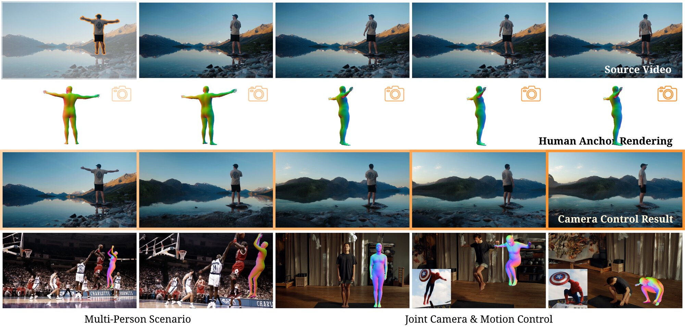

# Anchor the Man, Move the Camera

Yuntian Ke<sup>1</sup>, [Weijie Lyu](https://www.wlyu.me/)<sup>2</sup>, [Shuo Chen](https://chenshuo20.github.io/)<sup>2</sup>, [Zhixin Shu](https://zhixinshu.github.io/)<sup>3</sup>, [Ming-Hsuan Yang](https://faculty.ucmerced.edu/mhyang/)<sup>2</sup>  
<sup>1</sup>University of Pennsylvania &nbsp; <sup>2</sup>University of California, Merced &nbsp; <sup>3</sup>Adobe Research

[](https://kytttt.github.io/AnchorMan/) [](https://www.youtube.com/watch?v=Eun-5j4_bW8)
<!-- [](https://arxiv.org/abs/XXXX.XXXXX) -->

<div align='center'>

</div>

> **AnchorMan** uses the reconstruction of a human in the scene as the anchor to control the camera for video generation. It can be applied to multi-person scenarios. Given an image input and a driving video, the anchor representation can also be used for motion control.

## 🚀 Code

Code coming soon.

## 📝 Citation

If you find our work useful for your project, please consider citing our paper.

```bibtex
@article{ke2026anchorman,
  title   = {Anchor the Man, Move the Camera},
  author  = {Ke, Yuntian and Lyu, Weijie and Chen, Shuo and Shu, Zhixin and Yang, Ming-Hsuan},
  journal = {arXiv preprint},
  year    = {2026}
}
```
